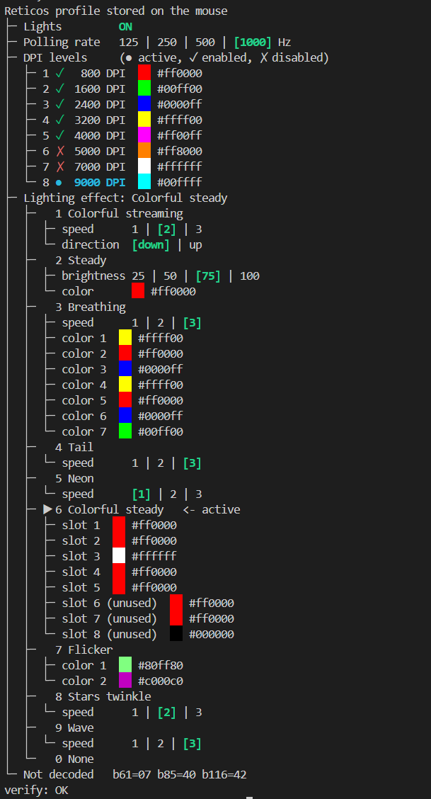
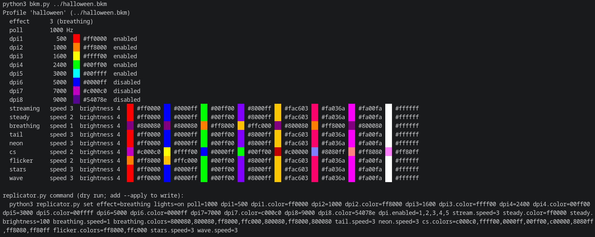

# reticos-rgb

Control the on-board profile of the **Speedlink RETICOS RGB Gaming Mouse** (SL-680011-BK, hardware rev "V3")
from Python, on Windows and Linux, without the vendor driver. Reverse-engineered from a USB capture of the
official driver. Also the basis for an [OpenRGB controller](#openrgb).

- Mouse: [Speedlink RETICOS RGB](https://speedlink.com/en/RETICOS-RGB-Gaming-Mouse-black/SL-680011-BK)
  (USB `258a:003b`, "SINOWEALTH Wired Gaming Mouse", sensor id 0x3325 per the driver config)
- Vendor driver: version 1.0.4 from the product page's downloads. It is a generic Sinowealth "BY-COMBO2" utility.
  Not included in this repo.
- OpenRGB: working controller on the [`speedlink_reticos` branch](https://gitlab.com/inxomnyaa/OpenRGB/-/tree/speedlink_reticos)
  of my fork, not merged upstream yet (see [OpenRGB issue #6031](https://gitlab.com/CalcProgrammer1/OpenRGB/-/work_items/6031))



> **Status:** tested on one mouse (Windows 10 and Bazzite). Writes replace the whole profile on the mouse.
> Every write saves a backup first, but use at your own risk. Not affiliated with Speedlink or Sinowealth.

## Videos

Proof of concept on the real mouse, showing the protocol working:

- https://youtube.com/shorts/H0NoP6xH36E
- https://youtube.com/shorts/dL6Rb53NHR8
- https://youtube.com/shorts/V4-nwEO19VA

## What it can set

Effects (1 Colorful streaming, 2 Steady, 3 Breathing, 4 Tail, 5 Neon, 6 Colorful steady, 7 Flicker,
8 Stars twinkle, 9 Wave, 0 None) with their speeds, directions, brightness and colors, global lights on/off,
the 8 DPI levels (value, color, enabled, active), and the polling rate (125/250/500/1000 Hz).
Colorful steady lights 5 zones: front, behind the wheel, in front of the DPI button, rear, logo.

## Files

| File | Purpose |
|---|---|
| `replicator.py` | Show the profile as a tree (colored swatches) and change settings |
| `bkm.py` | Read a profile exported by the Reticos software (`.bkm`) and print the matching `replicator.py set` command |
| `selftest.py` | Guided hardware test: writes one change at a time and asks you what the mouse did |
| `diag.py` | Linux diagnostic: lists hidraw nodes and what each probe returns |
| `linux/hid.py` | Minimal hidraw replacement for the `hid` module (Linux only, no pip needed) |
| `70-reticos.rules` | udev rule so you can run without sudo |

## Usage

Close the Reticos app first.

**Windows:** `pip install hidapi`, then

```
python replicator.py                                  # show profile (read-only)
python replicator.py set effect=cs cs.colors=ff0000,ff8000,ffff00,00ff00,00ffff        # dry run
python replicator.py set effect=cs cs.colors=ff0000,ff8000,ffff00,00ff00,00ffff --apply # write
python replicator.py set lights=toggle poll=1000 dpi4=3200 --apply
python replicator.py restore reticos_backup_XXXX.bin --apply
python selftest.py --list
```

**Linux:** no pip install. Either install the udev rule (`sudo cp 70-reticos.rules /etc/udev/rules.d/`,
`sudo udevadm control --reload-rules`, replug the mouse) or use sudo:

```
sudo env PYTHONPATH=linux python3 replicator.py
```

`python replicator.py` with no arguments never writes. Without `--apply`, `set` and `restore` are dry runs.
The keys for `set` are listed at the top of `replicator.py`.

### Vendor profiles (.bkm)

`bkm.py` reads a profile exported by the Reticos software and prints its settings plus the matching
`replicator.py set` command. It only reads the file, needs no mouse and works the same on Windows and Linux.

```
python bkm.py halloween.bkm
```



## Protocol in short

- Everything is HID feature reports on **interface 1**. Report 5 (6 bytes) is the command channel,
  report 4 (520 bytes) carries the profile.
- Handshake: `05 01` -> the mouse answers `05 01 39 36 31 30` ("9610"), then `05 02`.
- Read: send `05 11`, then GET report 4 (131 bytes come back). The mouse answers report 4 according to the
  last report 5 command.
- Write: the full profile as a 520-byte report 4, with bytes 3 = `0x7b`, 6 and 7 = 0. The driver does a
  read-modify-write for every UI change.
- Selected bytes: 10 polling rate, 11/12 DPI active level, count and disabled-level mask, 13-20 DPI table,
  29-52 DPI colors, 53 effect, 54-124 effect parameters, 130 global lights (0 on, 3 off).
- Settings from the Reticos app that are not on the mouse (sensitivity, scroll speed, pointer precision,
  double-click speed) are plain Windows mouse settings.

## OpenRGB

The [`speedlink_reticos` branch](https://gitlab.com/inxomnyaa/OpenRGB/-/tree/speedlink_reticos) of my OpenRGB fork
adds the Reticos as a variant of OpenRGB's existing Sinowealth (Glorious Model O) mouse controller. Same protocol
family; the differences are RGB instead of RBG color order, 5 LEDs, the lights on/off byte and two extra effects.

- Detected as "Speedlink Reticos", one zone with 5 LEDs (Front, Scroll Wheel, Middle, Rear, Logo)
- Modes: Custom (per-LED, effect 6), Static, Off, Breathing (7 colors), Rainbow Wave, Spectrum Cycle, Tail,
  Flashing (2 colors), Stars, Wave
- Reads the profile stored on the mouse at startup, so every mode starts with the mouse's own colors and speeds
- Off only switches the lights off and keeps the stored effect
- Skips the write when the mouse already holds the same profile
- DPI and polling rate are not part of OpenRGB; use `replicator.py` for those

Tested on Linux (Bazzite). It is not in upstream OpenRGB yet: [issue #6031](https://gitlab.com/CalcProgrammer1/OpenRGB/-/work_items/6031)
asks the maintainers whether they want a merge request for it. To try it now, build the branch, for example in a
Fedora distrobox:

```
distrobox create --name openrgb-dev --image registry.fedoraproject.org/fedora-toolbox:44
distrobox enter openrgb-dev -- sudo dnf install -y gcc-c++ make libusbx-devel qt6-qtbase-devel qt6-linguist hidapi-devel mbedtls-devel pkgconf git
git clone -b speedlink_reticos https://gitlab.com/inxomnyaa/OpenRGB.git && mkdir OpenRGB/build && cd OpenRGB/build
distrobox enter openrgb-dev -- bash -c 'qmake6 ../OpenRGB.pro && make -j$(nproc)'
distrobox enter openrgb-dev -- ./openrgb
```

## Not done / unknown

- The one-off `04 12` write (probably the button table) is not decoded or used.
- Bytes 61, 85, 116 are not understood (constant in all captures).
- The DPI encoding is verified for 200-5000 (steps of 100) and 5500-10000 (steps of 500).
- Whether writes wear the mouse's flash. Avoid streaming effects through it.

## License

MIT (see `LICENSE`).

## Credits

Reverse-engineered, written and tested by inxomnyaa together with [Claude](https://claude.ai) (Anthropic), which analyzed the USB capture and wrote the Python tools. All hardware testing was done by hand on a real mouse.